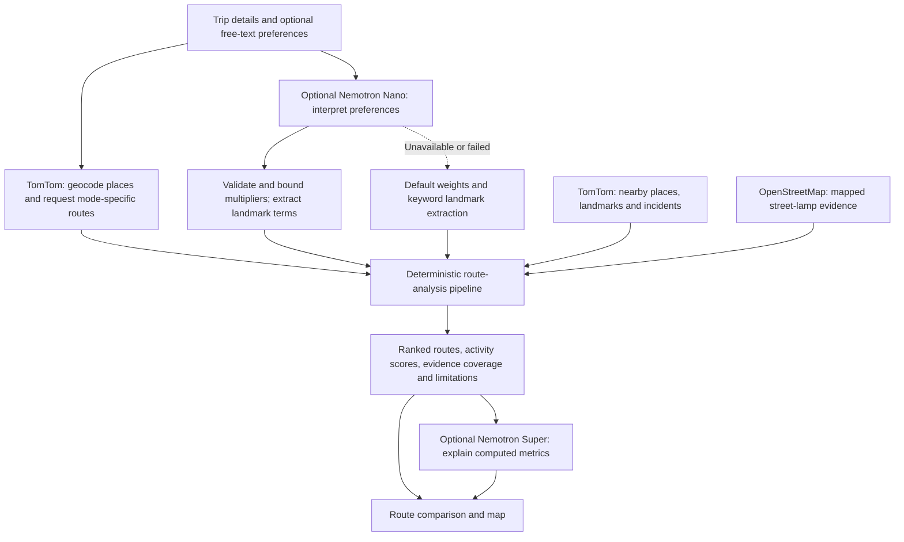
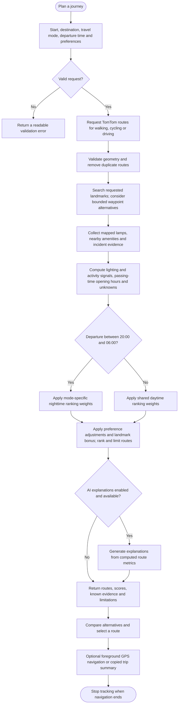

# City After Dark: Route Planner

Created and maintained by **Maneswar Sahu** (<maneswar.sahu2005@gmail.com>).

Copyright (c) 2026 Maneswar Sahu. Released under the [MIT License](LICENSE). Third-party data retains its own attribution and licensing.

A route comparison and navigation app for Bengaluru-style trips, with a night-friendly interface that works for daytime journeys too. TomTom supplies geocoding, route geometry, travel-time summaries, along-route places and incidents. OpenStreetMap street-lamp nodes provide a mapped-lighting signal. NVIDIA Nemotron models, served through **Nebius Token Factory**, turn free-text preferences into ranking adjustments and landmark searches, and narrate the comparison between routes; all provider failures degrade gracefully (the app still returns routes and metrics if an LLM call fails or times out).

**This is not crime data, a safety service, or a safety guarantee.** A mapped OpenStreetMap lamp does not confirm that it works, and missing lamp data does not establish darkness.

## Motivation

[YouGov's October 2020 survey](https://yougov.com/articles/32860-most-urban-indian-women-feel-unsafe-while-walking-) reported that 52% of urban Indian women always or often felt unsafe walking alone at night; 18% felt unsafe walking alone during the day. The online survey involved around 700 women in India and was published on 4 November 2020. These historical perceptions motivate clearer journey context; they are not crime rates, current local risk estimates or inputs to route scores.

## Interface and journey tools

- Dark panels and a coordinated dark basemap, with mint routes and amber mapped lamps.
- Driving, walking and cycling; typed place search, current location and map picking.
- Editable preferences with one-tap prompts, swapped endpoints and a local-time “Leave now” shortcut.
- Route time comparisons, evidence coverage, explicit unknowns and expandable provider limitations.
- Foreground GPS route following and a copyable trip summary, with manual-copy fallback. Summaries do not share live location; sharing remains your choice.
- Phone, tablet and desktop layouts. No account or persistent trip history is required.

## Nebius / NVIDIA usage



Preference interpretation overlaps geocoding and initial routing. AI output adjusts preferences and explanations; TomTom supplies route geometry. Routes remain available if an AI call fails.

- **Provider**: [Nebius Token Factory](https://tokenfactory.nebius.com) (OpenAI-compatible `chat/completions`, JSON mode), see [`app/clients/nebius.py`](app/clients/nebius.py). Nemotron 3 reasons by default; we send `chat_template_kwargs: {"enable_thinking": false}` because for these short structured tasks reasoning consumed the whole token budget and returned no content (~37 s → ~2.7 s with it off).
- **Intent agent** — `nvidia/NVIDIA-Nemotron-3-Nano-30B-A3B` ([`app/agents/agent2a_intent.py`](app/agents/agent2a_intent.py)) maps free text to 0.5–1.5× multipliers on nine named ranking factors (police, lighting, open shops, hospitals, residential, night activity, delay, closures, duration) plus up to three landmark search terms. Output is validated and clamped server-side; unknown factors are dropped. Falls back to default weights and keyword extraction if the call fails.
- **Route explainer** — `nvidia/nemotron-3-super-120b-a12b` ([`app/agents/explainer.py`](app/agents/explainer.py)) receives only the structured metrics the backend computed plus the parsed priorities, writes one explanation per route, and is post-filtered for "guaranteed safe"-style phrasing.
- The LLMs never choose geometry or touch TomTom/OSM data directly; the UI labels which model produced what.
- **Where Token Factory sped up the build** — no GPUs to provision and no model hosting. One API key and one OpenAI-compatible endpoint serve both Nemotron sizes, so the whole Nebius client is ~40 lines of `httpx` with no SDK. Comparing Nano and Super on the same prompt was a one-string change, which is how we sized each model to its task and found the reasoning switch above.
- **Other Nebius services** — none. The app runs in a Docker container on Render and calls Token Factory over HTTPS; the API key is a server-side environment variable.

## Route-analysis flowchart



Nighttime is determined in the requested timezone: 20:00 inclusive to 06:00 exclusive. Unavailable evidence stays unknown; the pipeline does not infer crime risk or verify that mapped lamps work. Provider failures can reduce the available evidence; failure to obtain valid routes returns an error.

## Requirements

- Python 3.11+
- Node.js 20+
- TomTom API key for live routes; Nebius Token Factory API key for the AI-parsed preferences and route explanations (optional — the app still works without it, just without the LLM features)

## Configure and run

Copy `.env.example` to `.env` and set `TOMTOM_API_KEY` and `NEBIUS_API_KEY`. Keep `VITE_TOMTOM_API_KEY` equal to `TOMTOM_API_KEY` for the TomTom vector basemap. Without a basemap key, the frontend falls back to the public OpenFreeMap Liberty style. Typed place suggestions are also powered by TomTom and return exact coordinates for either field.

Backend, from the repository root (macOS/Linux):

```bash
python3 -m venv .venv
source .venv/bin/activate
pip install -e ".[dev]"
uvicorn app.main:app --reload
```

Windows (PowerShell):

```powershell
py -m venv .venv
.\.venv\Scripts\Activate.ps1
pip install -e .[dev]
uvicorn app.main:app --reload
```

Frontend, in `web/`:

```bash
npm install
npm run dev
```

The Vite dev server proxies `/api` to `http://127.0.0.1:8000`. To serve a production build through FastAPI, run `npm run build` in `web/`, then start the backend — it automatically mounts `web/dist` at `/` when present.

## Deploying

A multi-stage `Dockerfile` builds the frontend and serves it from FastAPI in one container; `render.yaml` describes it as a [Render](https://render.com) Blueprint. To deploy on Render: connect this repo as a new Blueprint, and set `TOMTOM_API_KEY`, `NEBIUS_API_KEY`, and `VITE_TOMTOM_API_KEY` (same value as `TOMTOM_API_KEY`) as secret environment variables in the dashboard — everything else has a sane default in `render.yaml`. Any other Docker-capable host works the same way: `docker build --build-arg VITE_TOMTOM_API_KEY=... -t city-after-dark . && docker run -p 8000:8000 --env-file .env city-after-dark`.

## Route and search settings

`MAX_ROUTES` and `DEFAULT_MAX_ROUTES` control the route-count selector (maximum 5). `PLACE_SEARCH_LIMIT` (1–20) controls TomTom autocomplete results, and `PLACE_SEARCH_RADIUS_METERS` controls the strength of its soft nearby bias; it does not exclude matching places outside that radius. Frontend defaults are configurable through `VITE_MAX_ROUTES`, `VITE_DEFAULT_MAX_ROUTES`, `VITE_SEARCH_DEBOUNCE_MS`, and `VITE_MIN_SEARCH_LENGTH` in the root `.env`; restart Vite after changing these. Place suggestions use TomTom fuzzy typeahead and rank lexical/provider relevance first, with proximity from the selected start or current map center as a supporting signal.

Route preferences are also considered in candidate generation and ranking. For example, “prefer a route with a lake” searches TomTom along each route; if that returns no match, it searches around several points along each route, biased to a configurable 5 km radius and constrained to India. A discovered lake outside the route corridor can be used as an explicit routing waypoint to create a genuine longer alternative. `PREFERENCE_ROUTE_CANDIDATES` (default 3) caps waypoint-route requests; `PREFERENCE_SEARCH_RADIUS_METERS` and `PREFERENCE_SEARCH_POINTS_PER_ROUTE` control fallback discovery; `PREFERENCE_CORRIDOR_METERS` (default 500 m) determines when a found POI counts as already on a route; `PREFERENCE_MATCH_BONUS` (default 0.35) controls ranking. Matched landmarks are shown on the map. This depends on TomTom POI coverage and cannot guarantee every landmark is indexed; limitations are returned with the routes.

Choose a route card, then press **Start navigation** to grant foreground GPS access. The map follows your position, shows the remaining route distance and displays TomTom instructions when available. This is a basic live route-following feature, not turn-by-turn voice guidance. Location tracking stops when you press **Stop navigation**, select a different route, or submit a new search.

## API

`GET /api/health`

`POST /api/routes/analyze`

Example request:

```json
{
  "start": "Bellandur, Bengaluru",
  "destination": { "lat": 12.9352, "lon": 77.6245 },
  "mode": "car",
  "maxRoutes": 3,
  "departureTime": null,
  "timezone": "Asia/Kolkata",
  "preferences": "Prefer open shops, hospitals, police and residential stretches"
}
```

Start and destination can each be a place string or `{ "lat": ..., "lon": ... }`. Supported modes: `car`, `pedestrian`, `bicycle`. Response routes include GeoJSON LineStrings, `nightActivityScore`, `streetLightingScore`, lamp points, POI features, signal breakdowns, missing signals and limitations.

## Data and limitations

- The service does not request or infer crime data.
- Unknown business hours receive no positive credit; unknown is not considered closed.
- Route requests send the selected departure date/time to TomTom (`departAt`) for time-dependent routing. TomTom's documented traffic support includes live/current traffic and typical weekday/time speeds; exact future incidents should not be treated as known.
- Street lamps inside the Bengaluru metro area come from a bundled OpenStreetMap snapshot ([`app/data/bengaluru_street_lamps.json`](app/data/bengaluru_street_lamps.json), © OpenStreetMap contributors, [ODbL](https://opendatacommons.org/licenses/odbl/)). The public Overpass API took 30+ seconds or returned 502/504 for a single route corridor, so live queries are only used outside that area. Configure `OVERPASS_URL` if using an approved alternative endpoint.
- Street-lamp scores are relative across returned alternatives. OSM tagging is incomplete; the score is not a measurement of functioning lights.
- Unknown Night Activity signals count as neutral (50%), not as good or bad, and each route reports what share of the score is backed by evidence, so a single strong signal cannot produce a perfect score.
- TomTom POIs and category coverage can be incomplete. Residential coverage is a category-evidence estimate, not a density claim. TomTom Search calls are throttled to ~4 requests/second with retry on HTTP 429.
- Flow sampling and route-specific residential reverse-geocoding are not enabled; unavailable signals are surfaced rather than synthesized.
- This demo uses in-process provider clients and no persistent cache, queue or database.

## Checks

```bash
pytest
cd web && npm run build
npm test
```

Browser tests use installed Google Chrome locally and Playwright Chromium when `CI` is set (install it with `npx playwright install --with-deps chromium` in your CI environment). They cover desktop, tablet and phone sizes with deterministic routing, map, GPS and clipboard fixtures. They do not verify live provider coverage or consume API quotas. Run all checks before deployment.

## Deployment checklist

1. Connect this repository to Render as a Blueprint using `render.yaml`. The Dockerfile builds the frontend and serves the complete application through FastAPI; a separate frontend host is unnecessary.
2. Set `TOMTOM_API_KEY` for live routing and place search. `NEBIUS_API_KEY` is optional for preference interpretation and explanations. Set `VITE_TOMTOM_API_KEY` at build time to use the TomTom basemap; without it the map uses OpenFreeMap.
3. Keep provider keys in the host's secret environment settings. The `VITE_` basemap key is intentionally browser-visible; restrict its allowed domains and usage in your TomTom account. Backend keys must never use a `VITE_` prefix.
4. Render checks `/api/health`. After deployment, verify the homepage, place suggestions, a daytime and nighttime route request, and location permission handling over HTTPS. Health confirms the server is running, not that provider keys or quotas are valid.
5. GPS and clipboard access require HTTPS (or localhost). Configure `CORS_ORIGINS` only if hosting the frontend on a separate origin. If build-time `VITE_` settings change, rebuild the service.

Docker is not required for local development. To validate the same production serving path locally, build `web/`, start `uvicorn app.main:app`, and open `http://127.0.0.1:8000`.
