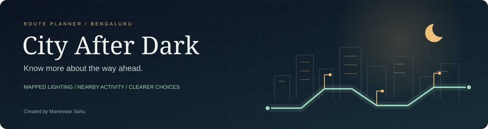
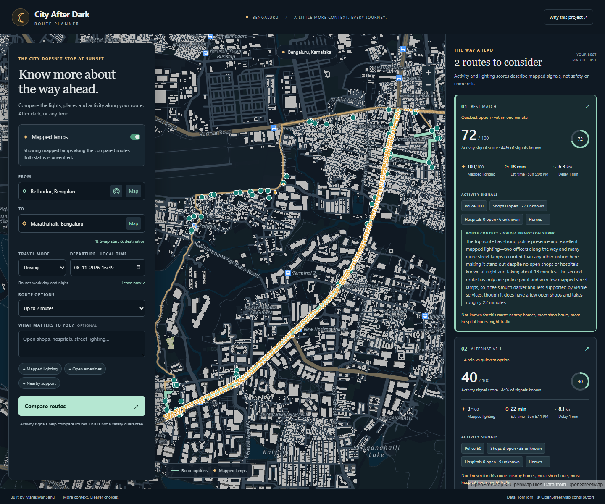
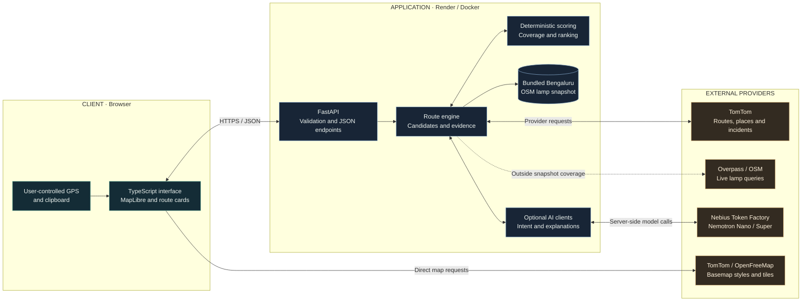
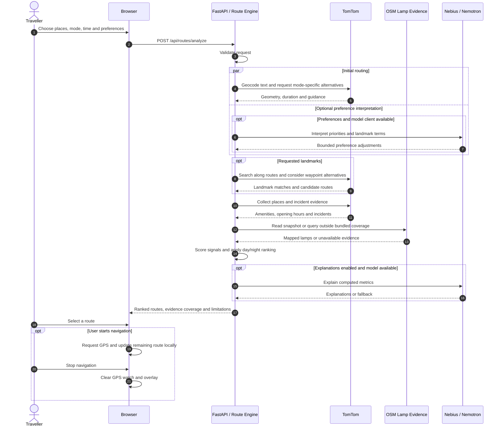

<div align="center">

# City After Dark: Route Planner

**A journey is more than a line on a map.**

Compare routes through Bengaluru using mapped lighting, nearby activity, travel time and your preferences—after dark, or any time.

[**Open the live app ↗**](https://city-after-dark.onrender.com) · [Architecture](#high-level-design) · [Run locally](docs/DEVELOPMENT.md#configure-and-run) · [API](docs/DEVELOPMENT.md#api)


[](LICENSE)

Created and maintained by **[Maneswar Sahu](https://github.com/ManeswarSahu11)**.

</div>

> **Evidence, not guarantees.** This app compares mapped signals. It does not provide crime data, verify that lamps work, or guarantee personal safety.

## A look inside



*An example journey in the actual application. Options and scores depend on departure time, preferences and available provider evidence.*

## What you can do

| Plan | Compare | Follow |
| --- | --- | --- |
| Walk, cycle or drive | Time, distance and route trade-offs | Foreground GPS route following |
| Search places or pick points on the map | Mapped lamps and nearby amenities | Remaining distance and available instructions |
| Set departure time and preferences | Evidence coverage and explicit unknowns | Copy a trip summary without live tracking |

The interface works on phones, tablets and desktops. Preference shortcuts, swapped endpoints and a “Leave now” action keep repeat planning quick.

## Why this project exists

In [YouGov's October 2020 survey](https://yougov.com/articles/32860-most-urban-indian-women-feel-unsafe-while-walking-), 52% of urban Indian women reported always or often feeling unsafe walking alone at night; 18% reported feeling unsafe walking alone during the day. Around 700 women participated online; the article was published on 4 November 2020.

These historical perceptions motivate more transparent journey information. They are not crime rates, current local risk estimates or inputs to the algorithm.

## High-level design

One Docker service contains the compiled frontend and FastAPI backend. External providers supply route and map evidence; the application computes and ranks the comparison.



| Boundary | Responsibility | Implementation |
| --- | --- | --- |
| Browser | Inputs, map, selection, GPS and copy actions | [`web/src/main.ts`](web/src/main.ts), [`web/src/map/`](web/src/map/) |
| API | Validate requests and return structured results | [`app/api/routes.py`](app/api/routes.py), [`schemas.py`](app/models/schemas.py) |
| Orchestration | Alternatives, landmarks and evidence collection | [`agent1_route_engine.py`](app/agents/agent1_route_engine.py) |
| Scoring | Calculate signals, account for unknowns and rank routes | [`app/scoring/`](app/scoring/) |
| AI | Interpret preferences and explain computed metrics | [`app/agents/`](app/agents/), [`nebius.py`](app/clients/nebius.py) |

**Current deployment:** one service with in-process provider clients; no persistent database, shared cache, background queue or custom model hosting. Backend keys stay server-side. An optional `VITE_` basemap key is browser-visible.

## A route request, end to end



AI does not invent route geometry or safety labels. Failed AI calls fall back to default preference handling or omit explanations. Failure to obtain valid routes returns an error; missing optional evidence is reported.

## How alternatives are ranked

1. Request mode-specific routes and remove duplicate or invalid geometry.
2. Search requested landmarks and consider bounded waypoint alternatives.
3. Compute lighting, amenities, residential and incident signals, including opening hours at estimated passing times.
4. Apply mode-specific nighttime weights or shared daytime weights, with user-preference adjustments and landmark bonuses.
5. Return ranked alternatives with evidence coverage and explicit unknowns.

**Night:** 20:00 inclusive to 06:00 exclusive in the requested timezone. Ranking coefficients are application rules, not validated safety probabilities. [Scoring and resilience design →](docs/ARCHITECTURE.md)

## Get it running

Requirements: **Python 3.11+**, **Node.js 20+**, and a **TomTom API key**. A Nebius key is optional for AI preference interpretation and explanations.

```bash
git clone https://github.com/ManeswarSahu11/city-after-dark.git
cd city-after-dark
```

Copy `.env.example` to `.env`, add the provider keys, then start the backend and frontend in separate terminals. Follow the [platform-specific setup instructions](docs/DEVELOPMENT.md#configure-and-run).

| Task | Command | Directory |
| --- | --- | --- |
| Install backend | `pip install -e ".[dev]"` | Root, inside a virtual environment |
| Run backend | `uvicorn app.main:app --reload` | Root |
| Install frontend | `npm ci` | `web/` |
| Run frontend | `npm run dev` | `web/` |
| Build frontend | `npm run build` | `web/` |

**Deploy:** [`Dockerfile`](Dockerfile) builds and serves the complete app through FastAPI. [`render.yaml`](render.yaml) provides a reusable Render Blueprint. The live service runs on Render. [Deployment and secret configuration →](docs/DEVELOPMENT.md#deployment-checklist)

## Validation

The most recent full local regression run passed **46 backend tests** and **39 browser checks** across desktop, tablet and phone layouts. These are recorded results, not a continuously updated CI badge.

| Check | Coverage |
| --- | --- |
| `pytest -q` | Validation, provider handling, scoring, preferences and route processing |
| `npm test` in `web/` | Forms, mode/time requests, lamp layers, missing data, copy fallback and GPS lifecycle |
| `npm run build` in `web/` | TypeScript checking and production frontend build |

Browser regressions use deterministic provider fixtures. Separate live deployment checks verified the homepage, health, place search, routing, AI preferences, explanations and lamp points. [Test setup →](docs/DEVELOPMENT.md#checks)

## Limits worth understanding

- Mapped lamps do not verify functioning bulbs or current illumination.
- Missing map data is not evidence that a street is dark or dangerous.
- Unknown opening hours receive no positive credit; provider coverage can be incomplete.
- Scores are not crime forecasts, emergency assistance or safety guarantees.
- GPS navigation is foreground route following, not background tracking or voice guidance.
- Walking and cycling share amenity-eligibility rules; there is no independent pavement, cycle-lane, slope or surface-quality score.

[Full data limitations and attribution →](docs/DEVELOPMENT.md#data-and-limitations)

## Project map

```text
app/
  api/            HTTP endpoints
  agents/         Route orchestration, preferences and explanations
  clients/        TomTom, Overpass and Nebius adapters
  data/           Bundled Bengaluru lamp snapshot
  models/         Request and response contracts
  scoring/        Signal calculation and ranking
web/
  src/            TypeScript UI, maps and API clients
  tests/          Playwright browser regressions
tests/            Python backend tests
docs/             Architecture, setup and presentation assets
```

## License and attribution

Copyright © 2026 **Maneswar Sahu**. Software is released under the [MIT License](LICENSE).

Bundled lighting data: **© OpenStreetMap contributors**, licensed under [ODbL](https://opendatacommons.org/licenses/odbl/). Map attribution remains visible in the application. Research sources are credited separately above.
