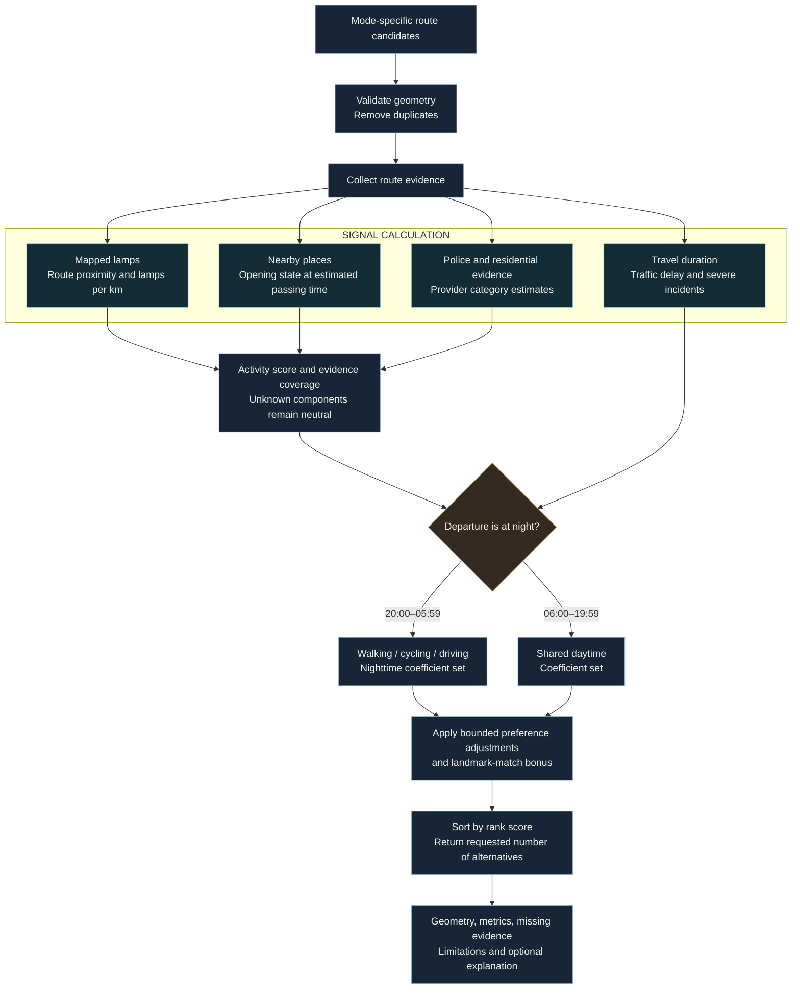
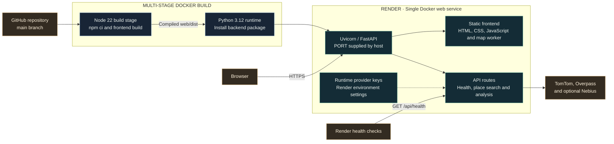

# Architecture and design notes

[Project overview](../README.md) · [Development and deployment](DEVELOPMENT.md)

This document describes the implemented system. It does not represent a proposed distributed architecture or claim that route scores measure personal safety.

## Scope and boundaries

| Inside the application | Supplied externally | Not implemented |
| --- | --- | --- |
| Request validation and route orchestration | TomTom route geometry, place search and incidents | Crime prediction or emergency dispatch |
| Deterministic signals, evidence coverage and ranking | OpenStreetMap lamp mapping | Verified bulb status or measured illumination |
| Preference validation and grounded explanations | Nemotron inference through Nebius | Custom model training or GPU hosting |
| Browser map, foreground GPS and clipboard actions | TomTom or OpenFreeMap basemap tiles | Background location sharing or persistent trip accounts |

## Evidence to ranking

Night is based on the requested timezone, not the device's display theme. The range is 20:00 inclusive to 06:00 exclusive.

### Mode-specific behaviour

| Rule | Walking | Cycling | Driving |
| --- | --- | --- | --- |
| TomTom travel mode | `pedestrian` | `bicycle` | `car` |
| Lamp proximity threshold | 40 m | 40 m | 50 m |
| Eligible amenity mode tags | Pedestrian, bicycle or all | Pedestrian, bicycle or all | Car or all |
| Night activity coefficient | 0.55 | 0.50 | 0.45 |
| Night open-amenity coefficient | 0.15 | 0.18 | 0.15 |
| Night severe-incident penalty | 0.15 | 0.16 | 0.20 |
| Night extra-time penalty | 0.15 | 0.16 | 0.20 |

These coefficients are configurable through bounded preference multipliers, not calibrated safety probabilities. Walking and cycling currently share amenity eligibility. Daytime uses common base ranking coefficients across modes, while provider geometry, travel times and passing-time opening states still change.

The travel-time penalty compares alternatives with the quickest returned trip. Trips within 10% of the fastest duration receive no extra-time penalty. A landmark-match bonus can also affect the final rank.

### Interpreting the scores

- The activity score combines mapped lighting, police evidence, open amenities and residential evidence. Unknown components contribute a neutral 50% rather than positive evidence.
- Night traffic activity is currently unavailable; no synthetic substitute is generated.
- Lighting scores are relative across the returned alternatives. The same street can receive a different relative lighting score in a different candidate set.
- During daytime, the activity score's amenity components use a 21:00 reference; route-card open counts use actual estimated passing times. This reference does not assert future opening conditions are certain.
- The system does not independently score pavements, protected cycle lanes, slope or road-surface quality.

Sources: [`weights.py`](../app/scoring/weights.py), [`ranking.py`](../app/scoring/ranking.py), [`night_activity.py`](../app/scoring/night_activity.py), [`route engine`](../app/agents/agent1_route_engine.py).

## AI responsibilities

| Component | Model through Nebius Token Factory | Permitted output |
| --- | --- | --- |
| Preference interpretation | `nvidia/NVIDIA-Nemotron-3-Nano-30B-A3B` | Known ranking-factor multipliers bounded to 0.5–1.5, priorities and up to three landmark terms |
| Route explanation | `nvidia/nemotron-3-super-120b-a12b` | Text describing only the supplied computed route metrics |

The clients use an OpenAI-compatible HTTP endpoint. Structured preference output is validated; unknown factors are discarded. Explanation text is filtered for unsupported safety-guarantee language. Neither model directly requests map data or generates route geometry. AI is optional; TomTom is required for live routing.

Sources: [`agent2a_intent.py`](../app/agents/agent2a_intent.py), [`explainer.py`](../app/agents/explainer.py), [`nebius.py`](../app/clients/nebius.py).

## Deployment design

The Dockerfile builds one image; frontend and backend do not require separate hosts. The bundled OSM snapshot is packaged with the Python application. No database, queue or shared cache is provisioned.

An optional TomTom browser basemap key is injected at frontend build time and is intentionally visible to the browser. Backend TomTom and Nebius keys are runtime configuration. The Render API key is only for local deployment administration and is not an application environment variable.

## Failure handling

| Failure or missing input | Current behaviour |
| --- | --- |
| Missing required TomTom key | Route analysis and place search cannot run; the API returns an error |
| Invalid or duplicate-only route geometry | The request fails rather than inventing a route |
| Missing Nebius key or failed intent call | Default weights and keyword-based landmark extraction |
| Failed explanation call | Route metrics remain available without an explanation |
| Covered Bengaluru lamp request | Use the bundled OSM snapshot |
| Live lamp query unavailable | Surface missing lighting evidence; do not infer darkness |
| Unknown business hours | No positive open-amenity credit |
| Geolocation permission denied | Show a readable message and clear the navigation watch |
| GPS arrives before the map is ready | Wait for map readiness; ignore callbacks from stopped sessions |
| Clipboard access denied | Show a manually copyable trip summary |

The health endpoint checks server availability; it does not validate provider keys or quotas. Provider coverage, rate limits and outages remain external dependencies.

## Design choices and trade-offs

| Choice | Benefit | Current limit |
| --- | --- | --- |
| One application container | Straightforward deployment and one origin for the UI/API | No distributed scaling or background worker pipeline |
| Bundled Bengaluru lamp snapshot | Avoids slow live queries inside its coverage area | Snapshot freshness and incomplete OSM tagging |
| Deterministic ranking with optional AI | Geometry and scores remain inspectable when models fail | Ranking coefficients are design choices, not validated risk estimates |
| No app-managed trip database | No account setup or trip-history storage needed | No synced saved journeys or cross-device history |
| Browser-controlled location | GPS starts only after a user action | Foreground operation and browser permission requirements |

Provider services and hosting logs are separate from app-managed trip storage. The absence of a trip database is not a claim that third-party providers retain no request data.
